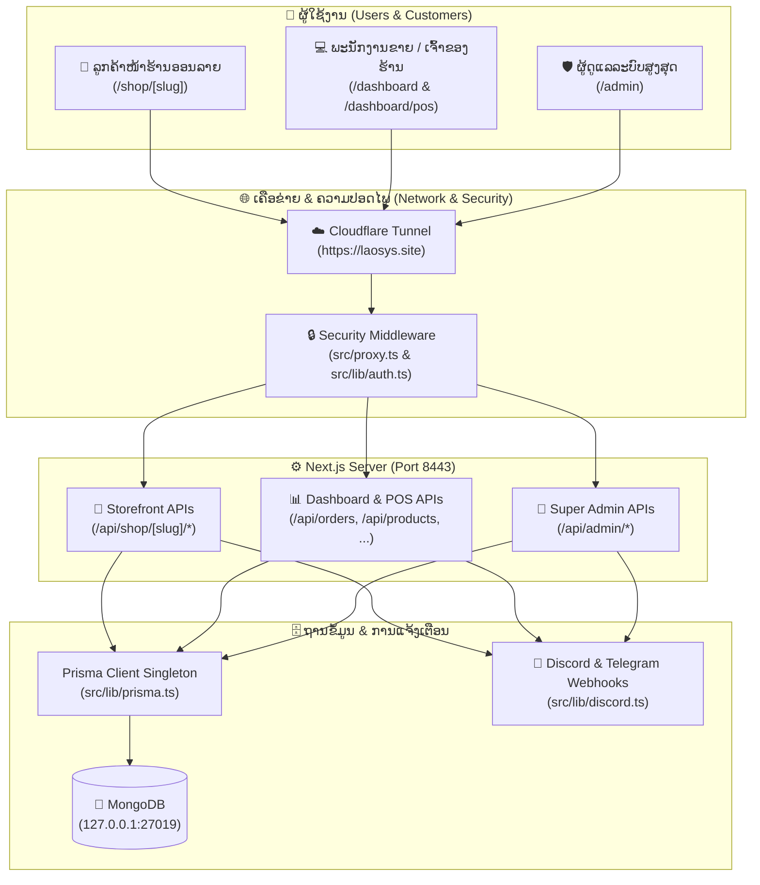

# 🏛️ LAOSYS — ຄູ່ມືສະບັບສົມບູນຂອງລະບົບ Multi-Tenant Enterprise POS & E-Commerce SaaS

ຍິນດີຕ້ອນຮັບສູ່ຄູ່ມືຫຼັກຢ່າງເປັນທາງການຂອງໂຄງການ **LAOSYS Platform**. ເອກະສານສະບັບນີ້ຖືກອອກແບບມາເພື່ອເປັນ **"ແຜນທີ່ນຳທາງ ແລະ ຄູ່ມືແກ້ໄຂບັນຫາແບບຄົບວົງຈອນ"** ສຳລັບຜູ້ພັດທະນາ (Developers), ຜູ້ດູແລລະບົບ (System Admins), ແລະ ທີມງານທຸກຝ່າຍ ເພື່ອໃຫ້ຮູ້ວ່າລະບົບນີ້ເຮັດວຽກແນວໃດ, ມີຟີເຈີຫຍັງແດ່, ຖ້າຕ້ອງການແກ້ໄຂສ່ວນໃດຕ້ອງເຂົ້າໄປທີ່ໄຟລ໌ໃດ ແລະ ຖ້າເກີດບັນຫາຕ້ອງແກ້ໄຂແນວໃດ.

---

## 📑 ສາລະບານ (Table of Contents)
1. [ພາບລວມຂອງໂຄງການ (Project Overview)](#1-ພາບລວມຂອງໂຄງການ-project-overview)
2. [ສະຖາປັດຕະຍະກຳ ແລະ ການເຮັດວຽກຂອງລະບົບ (System Architecture)](#2-ສະຖາປັດຕະຍະກຳ-ແລະ-ການເຮັດວຽກຂອງລະບົບ-system-architecture)
3. [ຂໍ້ມູນເຊີເວີ, ພອດ (Ports) ແລະ ການເຊື່ອມຕໍ່ (Network & Ports)](#3-ຂໍ້ມູນເຊີເວີ-ພອດ-ports-ແລະ-ການເຊື່ອມຕໍ່-network--ports)
4. [ແຜນທີ່ໄຟລ໌ແຍກຕາມຝ່າຍ — ຢາກແກ້ຫຍັງ ຕ້ອງໄປໄຟລ໌ໃດ? (File Navigation Map)](#4-ແຜນທີ່ໄຟລ໌ແຍກຕາມຝ່າຍ--ຢາກແກ້ຫຍັງ-ຕ້ອງໄປໄຟລ໌ໃດ-file-navigation-map)
   - [4.1 ຝ່າຍໜ້າຮ້ານອອນລາຍ (E-Commerce Storefront)](#41-ຝ່າຍໜ້າຮ້ານອອນລາຍ-e-commerce-storefront)
   - [4.2 ຝ່າຍຂາຍໜ້າຮ້ານ POS & ຮ້ານອາຫານ (POS, Cashier & Kitchen)](#42-ຝ່າຍຂາຍໜ້າຮ້ານ-pos--ຮ້ານອາຫານ-pos-cashier--kitchen)
   - [4.3 ຝ່າຍສິນຄ້າ ແລະ ສາງສິນຄ້າ (Products & Inventory)](#43-ຝ່າຍສິນຄ້າ-ແລະ-ສາງສິນຄ້າ-products--inventory)
   - [4.4 ຝ່າຍການຕະຫຼາດ, ຄູປອງ ແລະ ລູກຄ້າສຳພັນ (Marketing, Coupons & CRM)](#44-ຝ່າຍການຕະຫຼາດ-ຄູປອງ-ແລະ-ລູກຄ້າສຳພັນ-marketing-coupons--crm)
   - [4.5 ຝ່າຍບັນຊີ, ການເງິນ ແລະ ລາຍງານ (Accounting, Finance & Reports)](#45-ຝ່າຍບັນຊີ-ການເງິນ-ແລະ-ລາຍງານ-accounting-finance--reports)
   - [4.6 ຝ່າຍທຸລະກິດສະເພາະທາງ (Rental, Repairs, Clinic, Sports & Coaching)](#46-ຝ່າຍທຸລະກິດສະເພາະທາງ-rental-repairs-clinic-sports--coaching)
   - [4.7 ຝ່າຍຜູ້ດູແລລະບົບສູງສຸດ (Super Admin, Security & Webhooks)](#47-ຝ່າຍຜູ້ດູແລລະບົບສູງສຸດ-super-admin-security--webhooks)
   - [4.8 ຝ່າຍຖານຂໍ້ມູນ ແລະ ໄຟລ໌ Core Libraries (`src/lib`)](#48-ຝ່າຍຖານຂໍ້ມູນ-ແລະ-ໄຟລ໌-core-libraries-srclib)
5. [ຂັ້ນຕອນການ Build ແລະ Restart ລະບົບ (Build & Deployment Guide)](#5-ຂັ້ນຕອນການ-build-ແລະ-restart-ລະບົບ-build--deployment-guide)
6. [ຄູ່ມືແກ້ໄຂບັນຫາເມື່ອເກີດຂໍ້ຜິດພາດ (Troubleshooting & Maintenance)](#6-ຄູ່ມືແກ້ໄຂບັນຫາເມື່ອເກີດຂໍ້ຜິດພາດ-troubleshooting--maintenance)

---

## 1. ພາບລວມຂອງໂຄງການ (Project Overview)

**LAOSYS** ແມ່ນແພລດຟອມ **Multi-Tenant Enterprise SaaS** (ລະບົບດຽວຮອງຮັບຫຼາຍຮ້ານຄ້າ/ຫຼາຍບໍລິສັດ ໂດຍແຍກຂໍ້ມູນຂອງໃຜຂອງມັນຢ່າງเดັດຂາດດ້ວຍ `organizationId`). ລະບົບຖືກສ້າງຂຶ້ນເພື່ອຮອງຮັບທຸລະກິດໃນ ສປປ ລາວ ທຸກຮູບແບບ ຕັ້ງແຕ່ຮ້ານຂາຍຍ່ອຍ, ຮ້ານອາຫານ/ຄາເຟ່, ຮ້ານຄ້າອອນລາຍ, ທຸລະກິດໃຫ້ເຊົ່າ, ຮ້ານສ້ອມແປງ, ຄລີນິກ, ໄປຈົນເຖິງສະໜາມກິລາ.

### 🛠️ ເຕັກໂນໂລຊີຫຼັກທີ່ໃຊ້ (Tech Stack)
| ໝວດໝູ່ | ເຕັກໂນໂລຊີ | ລາຍລະອຽດການໃຊ້ງານ |
| :--- | :--- | :--- |
| **Framework** | **Next.js 16.2.7 (App Router)** | ຮອງຮັບທັງ Server Components (SSR) ແລະ Client Components ພ້ອມ API Routes ໃນຕົວ |
| **Frontend UI** | **React 19 + TypeScript** | ອິນເຕີເຟສທັນສະໄໝ, ໃຊ້ Tailwind CSS v4, Shadcn UI, ແລະ Lucide Icons |
| **Database** | **MongoDB (Port 27019)** | ຖານຂໍ້ມູນ NoSQL ທີ່ເກັບຂໍ້ມູນຮ້ານຄ້າ, ສິນຄ້າ, ອໍເດີ, ບັນຊີ ແລະ Audit Logs |
| **ORM** | **Prisma v6.19.3** | ໂຕຈັດການຖານຂໍ້ມູນ (`src/generated/prisma-v2`) ທີ່ຊ່ວຍກວດສອບ Type ຢ່າງແม่ນຍຳ |
| **Authentication** | **NextAuth.js v4 + JWT** | ລະບົບລັອກອິນ, ກວດສອບສິດ (RBAC), 2FA/MFA, ແລະ ລະບົບປ້ອງກັນການเดົາລະຫັດຜ່ານ |
| **Integrations** | **Discord / Telegram / Excel** | ແຈ້ງເຕືອນອໍເດີ/ຄວາມປອດໄພຜ່ານ Discord & Telegram, ສົ່ງອອກລາຍງານ Excel ພາສາລາວ |

---

## 2. ສະຖາປັດຕະຍະກຳ ແລະ ການເຮັດວຽກຂອງລະບົບ (System Architecture)



### 🔑 ຫຼັກການເຮັດວຽກທີ່ສຳຄັນ:
1. **Multi-Tenant Isolation (ການແຍກຂໍ້ມູນລະຫວ່າງຮ້ານຄ້າ):**
   - ທຸກໆຮ້ານຄ້າຈະມີ `Organization` ຂອງຕົນເອງ (ອ້າງອີງດ້ວຍ `organizationId` ແລະ `slug` ເຊັ່ນ `store-6a64a594`).
   - ສິນຄ້າ, ອໍເດີ, ຄູປອງ, ພະນັກງານ ແລະ **ສະມາຊິກລູກຄ້າອອນລາຍ** ຈະຖືກຜູກກັບ `organizationId` ສະເໝີ ເຮັດໃຫ້ຂໍ້ມູນຂອງແຕ່ລະຮ້ານບໍ່ປົນກັນເດັດຂາດ.
2. **Role-Based Access Control (ສິດທິຜູ້ໃຊ້ງານ):**
   - `SUPER_ADMIN`: ຄວບຄຸມທຸກຮ້ານຄ້າ, ອະນຸມັດບັນຊີ, ຕັ້ງຄ່າແພັກເກດ, ເບິ່ງ Logs ທັງໝົດ (`/admin/*`).
   - `ADMIN` / `OWNER`: ເຈົ້າຂອງຮ້ານຄ້າ ຈັດການຮ້ານຂອງຕົນເອງທັງໝົດ (`/dashboard/*`).
   - `STAFF` / `CASHIER`: ພະນັກງານຂາຍໜ້າຮ້ານ ໃຊ້ງານ POS ແລະ ຮັບອໍເດີ.
3. **Storefront Customer Session (ລູກຄ້າໜ້າຮ້ານອອນລາຍ):**
   - ລູກຄ້າທີ່ເຂົ້າຊື້ເຄື່ອງໃນ `/shop/[slug]` ບໍ່ຈຳເປັນຕ້ອງສະໝັກລະຫັດຜ່ານໃຫ້ยุ่งຍາກ ພຽງແຕ່ປ້ອນ **ເບີໂທລະສັບລາວ** (ຮອງຮັບທັງ `55558888`, `2055558888`, `02055558888`).
   - ລະບົບຈະແປງເປັນມາດຕະຖານ `020XXXXXXXX` ອັດຕະໂນມັດ ແລະ ບັນທຶກສິດການເກັບຄູປອງ (1 ເບີ / 1 ຄັ້ງ) ລົງໃນຖານຂໍ້ມູນຂອງຮ້ານນັ້ນໆໂດຍກົງ.

---

## 3. ຂໍ້ມູນເຊີເວີ, ພອດ (Ports) ແລະ ການເຊື່ອມຕໍ່ (Network & Ports)

ເພື່ອຄວາມປອດໄພສູງສຸດ (Security Hardening), ລະບົບໄດ້ປ່ຽນພອດມາດຕະຖານທັງໝົດໄປໃຊ້ພອດສະເພາະດັ່ງນີ້:

| ບໍລິການ (Service) | ພອດເດີມ | **ພອດປັດຈຸບັນ (Active Port)** | URL / ວິທີເຊື່ອມຕໍ່ |
| :--- | :---: | :---: | :--- |
| **Next.js Web Server** | ~~3000~~ | **`8443`** | `http://localhost:8443` ຫຼື `http://26.86.176.51:8443` |
| **Public Domain (HTTPS)** | 443 | **`443` (Tunnel -> 8443)** | `https://laosys.site` (ຜ່ານ Cloudflare Tunnel Service) |
| **MongoDB Database** | ~~27017~~ | **`27019`** | `mongodb://127.0.0.1:27019/pos_saas?directConnection=true` |
| **OpenSSH Server** | ~~22~~ | **`2222`** | `ssh -p 2222 khamla@26.86.176.51` |

---

## 4. ແຜນທີ່ໄຟລ໌ແຍກຕາມຝ່າຍ — ຢາກແກ້ຫຍັງ ຕ້ອງໄປໄຟລ໌ໃດ? (File Navigation Map)

ສ່ວນນີ້ຖືກຈັດໝວດໝູ່ຕາມໜ້າວຽກ ເພື່ອໃຫ້ທ່ານສາມາດກົດເຂົ້າໄປແກ້ໄຂໄຟລ໌ທີ່ຕ້ອງການໄດ້ທັນທີ:

---

### 4.1 🛒 ຝ່າຍໜ້າຮ້ານອອນລາຍ (E-Commerce Storefront)
> ໃຊ້ສຳລັບແກ້ໄຂໜ້າເວັບຂາຍເຄື່ອງອອນລາຍທີ່ລູກຄ້າເຂົ້າชมຜ່ານ `/shop/[slug]` (ເຊັ່ນ `https://laosys.site/shop/store-6a64a594`)

| ສິ່ງທີ່ຕ້ອງການແກ້ໄຂ | ໄຟລ໌ທີ່ຕ້ອງເປີດແກ້ (File Path) | ລາຍລະອຽດພາຍໃນໄຟລ໌ |
| :--- | :--- | :--- |
| **ໜ້າຮ້ານອອນລາຍທັງໝົດ (UI, ກະຕ່າ, ປ໊ອບອັບຄູປອງ, ໃບບິນພິມ A4/80mm)** | `src/app/shop/[slug]/ShopClient.tsx` | ໄຟລ໌ຫຼັກຂອງໜ້າຮ້ານອອນລາຍ: ລວມມີ Hero Banner, ລາຍການສິນຄ້າ, ກະຕ່າສິນຄ້າ, ຟອມຊຳລະເງິນ, ໃບບິນພິມເຈ້ຍຂາວ (`#printable-receipt-doc`), Modal ຕິດຕາມພັດສະດຸ ແລະ Modal ຄູປອງ. |
| **ການດຶງຂໍ້ມູນຮ້ານຄ້າ & ສິນຄ້າຂຶ້ນໜ້າເວັບ (Server Page)** | `src/app/shop/[slug]/page.tsx` | ດຶງຂໍ້ມູນຮ້ານຄ້າ, ສິນຄ້າທີ່ເປີດຂາຍ ແລະ ຄູປອງຈາກຖານຂໍ້ມູນສົ່ງໃຫ້ `ShopClient.tsx`. |
| **ລະບົບແປງເບີໂທລາວ (020 / 20 / 8 ໂຕເລກ)** | `src/lib/laoPhone.ts` | ຟັງຊັນ `normalizeLaoPhone()` ຮອງຮັບການພິມເບີໂທທຸກຮູບແບບ (ລວມທັງຕົວເລກລາວ `໐-໙`) ແລະ ກວດສອບເຄືອຂ່າຍ (Unitel, Lao Telecom, ETL, TPlus). |
| **ລະບົບສະມາຊິກລູກຄ້າອອນລາຍ & ປະຫວັດເກັບຄູປອງ** | `src/lib/storeCustomer.ts` | ຈັດການຂໍ້ມູນລູກຄ້າແຍກຕາມຮ້ານຄ້າ, ບັນທຶກຄູປອງທີ່ເກັບແລ້ວ ແລະ ໃຊ້ແລ້ວ (ຈຳກັດ 1 ເບີ / 1 ສິດ). |
| **API ສັ່ງຊື້ສິນຄ້າອອນລາຍ (Checkout)** | `src/app/api/shop/[slug]/checkout/route.ts` | ຮັບຄຳສັ່ງຊື້ຈາກລູກຄ້າ, ຕັດສະຕ໊ອກ, ບັນທຶກການໃຊ້ຄູປອງ, ສ້າງໃບບິນ ແລະ ສົ່ງແຈ້ງເຕືອນເຂົ້າຮ້ານ/Discord/Telegram. |
| **API ຕິດຕາມສະຖານະພັດສະດຸ (Track Order)** | `src/app/api/shop/[slug]/track/route.ts` | ຄົ້ນຫາອໍເດີດ້ວຍເບີໂທ, ລະຫັດບິນ ຫຼື ຊື່ລູກຄ້າ ພ້ອມລະບົບ Fuzzy Matching (ພິມເບີຜິດ 1 ໂຕກໍຍັງຄົ້ນຫາພົບ). |
| **API ລັອກອິນເບີໂທລູກຄ້າ & ກົດເກັບຄູປອງ** | `src/app/api/shop/[slug]/customer/route.ts`<br>`src/app/api/shop/[slug]/coupon/route.ts` | ຈັດການການເຂົ້າສູ່ລະບົບດ້ວຍເບີໂທ ແລະ ການກົດເກັບຄູປອງເຂົ້າກະເປົາລູກຄ້າ. |
| **ລາຍຊື່ແຂວງ/ເມືອງໃນລາວ & ບໍລິສັດຂົນສົ່ງ** | `src/lib/laoAddressData.ts` | ຂໍ້ມູນ 18 ແຂວງຂອງລາວ, ເມືອງຕ່າງໆ ແລະ ຂົນສົ່ງ (ອານຸສິດ, ຮຸ່ງອາລຸນ, ມີໄຊ). |
| **ຕັ້ງຄ່າໜ້າຮ້ານອອນລາຍ (ສຳລັບເຈົ້າຂອງຮ້ານ)** | `src/app/dashboard/settings/storefront/page.tsx`<br>`src/app/dashboard/ecommerce/page.tsx` | ໜ້າຕັ້ງຄ່າ Banner, ຂໍ້ຄວາມປະກາດ, ບັນຊີທະນາຄານ QR BCEL One ແລະ ธีມສີຂອງໜ້າຮ້ານ. |

---

### 4.2 💻 ຝ່າຍຂາຍໜ້າຮ້ານ POS & ຮ້ານອາຫານ (POS, Cashier & Kitchen)
> ໃຊ້ສຳລັບແກ້ໄຂລະບົບຂາຍໜ້າຮ້ານ, ການຄິດໄລ່ເງິນ, ການຈັດການໂຕະອາຫານ ແລະ ໜ້າຈໍເຮືອນຄົວ

| ສິ່ງທີ່ຕ້ອງການແກ້ໄຂ | ໄຟລ໌ທີ່ຕ້ອງເປີດແກ້ (File Path) | ລາຍລະອຽດພາຍໃນໄຟລ໌ |
| :--- | :--- | :--- |
| **ໜ້າຈໍຂາຍ POS ຫຼັກ** | `src/app/dashboard/pos/page.tsx`<br>`src/components/POSClient.tsx` | ໜ້າຈໍຂາຍສິນຄ້າໜ້າຮ້ານ, ສະແກນບາໂຄ້ດ, ເລືອກໂຕະ, ຄິດໄລ່ສ່ວນຫຼຸດ ແລະ ຊຳລະເງິນ. |
| **ໜ້າຈໍ Cashier ຮ້ານອາຫານ** | `src/app/dashboard/restaurant/cashier/page.tsx`<br>`src/app/api/restaurant/cashier/route.ts` | ລະບົບເກັບເງິນສຳລັບຮ້ານອາຫານ, ຈັດການບິນຕາມໂຕະ ແລະ ສະຖານະໂຕະ. |
| **ໜ້າຈໍເຮືອນຄົວ (Kitchen Display - KDS)** | `src/app/dashboard/restaurant/kitchen/page.tsx`<br>`src/app/api/restaurant/kds/route.ts` | ສະແດງລາຍການອາຫານທີ່ສັ່ງເຂົ້າເຮືອນຄົວແບບ Real-time ເພື່ອກົດປ່ຽນສະຖານະ (ກຳລັງປຸງແຕ່ງ / ສຳເລັດ). |
| **ການແຍກບິນ & ລວມໂຕະ (Split / Merge)** | `src/app/dashboard/restaurant/split-merge/page.tsx` | ຟີເຈີແຍກຈ່າຍ ຫຼື ຍ້າຍ/ລວມໂຕະອາຫານ. |
| **ຈັດການໂຊນໂຕະ & ຕົວເລືອກເພີ່ມເຕີມ (Modifiers)** | `src/app/dashboard/restaurant/zones/page.tsx`<br>`src/app/dashboard/restaurant/modifiers/page.tsx` | ຕັ້ງຄ່າໂຕະອາຫານ, ໂຊນນັ່ງ ແລະ ຕົວເລືອກອາຫານ (ເຊັ່ນ: ຫວານໜ້ອຍ, ເພີ່ມຊ໊ອດ). |
| **ໃບບິນອອນລາຍ & ກວດສອບໃບບິນແທ້** | `src/app/receipt/[id]/page.tsx`<br>`src/components/BillVerifyResult.tsx` | ໜ້າສະແດງໃບບິນເມື່ອສະແກນ QR Code ເພື່ອຢືນຢັນວ່າເປັນໃບບິນແທ້ຈາກທາງຮ້ານ. |

---

### 4.3 📦 ຝ່າຍສິນຄ້າ ແລະ ສາງສິນຄ້າ (Products & Inventory)
> ໃຊ້ສຳລັບແກ້ໄຂການເພີ່ມສິນຄ້າ, ໝວດໝູ່, ບາໂຄ້ດ, ຄັງສິນຄ້າ ແລະ ການນັບສະຕ໊ອກ

| ສິ່ງທີ່ຕ້ອງການແກ້ໄຂ | ໄຟລ໌ທີ່ຕ້ອງເປີດແກ້ (File Path) | ລາຍລະອຽດພາຍໃນໄຟລ໌ |
| :--- | :--- | :--- |
| **ຕາຕະລາງສິນຄ້າທັງໝົດ** | `src/app/dashboard/products/page.tsx`<br>`src/components/ProductTableClient.tsx` | ສະແດງລາຍການສິນຄ້າ, ຄົ້ນຫາ, ກັ່ນຕອງຕາມໝວດໝູ່ ແລະ ປ່ຽນສະຖານະສິນຄ້າ. |
| **ຟອມເພີ່ມສິນຄ້າໃໝ່ / ແກ້ໄຂສິນຄ້າ** | `src/components/CreateProductDialog.tsx`<br>`src/components/EditProductDialog.tsx` | Popup ສຳລັບເພີ່ມສິນຄ້າ, ອັບໂຫຼດຮູບພາບ, ຕັ້ງລາຄາທຶນ/ລາຄາຂາຍ ແລະ ຈຳນວນສະຕ໊ອກ. |
| **API ຈັດການສິນຄ້າ & ສະຕ໊ອກ** | `src/app/api/products/route.ts`<br>`src/app/api/products/[id]/route.ts`<br>`src/app/api/products/[id]/stock/route.ts` | Backend API ສຳລັບສ້າງ, ແກ້ໄຂ, ລຶບ ແລະ ປັບປຸງຍອດສະຕ໊ອກສິນຄ້າ. |
| **ຈັດການຄັງສິນຄ້າ (Warehouses & Transfers)** | `src/app/dashboard/inventory/warehouses/page.tsx`<br>`src/app/dashboard/inventory/transfers/page.tsx` | ຈັດການຫຼາຍສາງສິນຄ້າ ແລະ ການໂອນຍ້າຍສິນຄ້າລະຫວ່າງສາຂາ. |
| **ລະບົບບາໂຄ້ດ, ວັນໝົດອາຍຸ & Serial Number** | `src/app/dashboard/inventory/barcode/page.tsx`<br>`src/app/dashboard/inventory/expiry/page.tsx`<br>`src/app/dashboard/inventory/serial/page.tsx` | ພິມບາໂຄ້ດ, ແຈ້ງເຕືອນສິນຄ້າໃກ້ໝົດອາຍຸ ແລະ ກວດສອບເລກ Serial ອຸປະກອນໄອທີ. |
| **ໃບສັ່ງຊື້ສິນຄ້າເຂົ້າສາງ (Purchase Orders & Suppliers)** | `src/app/dashboard/inventory/purchase-orders/page.tsx`<br>`src/app/dashboard/inventory/suppliers/page.tsx` | ຈັດການຜູ້ສະໜອງ (Suppliers) ແລະ ອອກໃບສັ່ງຊື້ສິນຄ້າເຂົ້າຮ້ານ. |

---

### 4.4 🎟️ ຝ່າຍການຕະຫຼາດ, ຄູປອງ ແລະ ລູກຄ້າສຳພັນ (Marketing, Coupons & CRM)
> ໃຊ້ສຳລັບແກ້ໄຂລະບົບຄູປອງສ່ວນຫຼຸດ, ໂປຣໂມຊັນ, ສະມາຊິກ ແລະ ຄະແນນສະສົມ

| ສິ່ງທີ່ຕ້ອງການແກ້ໄຂ | ໄຟລ໌ທີ່ຕ້ອງເປີດແກ້ (File Path) | ລາຍລະອຽດພາຍໃນໄຟລ໌ |
| :--- | :--- | :--- |
| **ຈັດການຄູປອງສ່ວນຫຼຸດ (Coupon Manager)** | `src/app/dashboard/coupons/page.tsx`<br>`src/components/CouponManager.tsx`<br>`src/components/EditCouponDialog.tsx` | ສ້າງ/ແກ້ໄຂລະຫັດຄູປອງ (ເປີເຊັນ ຫຼື ຈຳນວນເງິນ), ຕັ້ງຍອດຊື້ຂັ້ນຕ່ຳ, ກຳນົດວັນໝົດອາຍຸ ແລະ ຈຳນວນສິດ. |
| **ຈັດການໂປຣໂມຊັນ & Flash Sale** | `src/app/dashboard/marketing/promotions/page.tsx`<br>`src/app/dashboard/marketing/flash-sale/page.tsx` | ຕັ້ງຄ່າແຄມເປນສ່ວນຫຼຸດພິເສດ ແລະ ສິນຄ້າລາຄາດ່ວນ. |
| **ຂໍ້ມູນລູກຄ້າ & ສະມາຊິກອອນລາຍ (CRM)** | `src/app/dashboard/customers/page.tsx`<br>`src/components/CustomerTableClient.tsx` | ເບິ່ງລາຍຊື່ລູກຄ້າທັງໝົດຂອງຮ້ານ, ເບີໂທ, ຍອດຊື້ສະສົມ ແລະ ປະຫວັດຄູປອງທີ່ລູກຄ້າເກັບໄປ. |
| **ລະບົບສະສົມแต້ມ (Loyalty & Points)** | `src/app/dashboard/customers/loyalty/page.tsx`<br>`src/app/dashboard/customers/points/page.tsx` | ຈັດການລະດັບສະມາຊິກ (VIP) ແລະ ການແລກຂອງລາງວັນ. |

---

### 4.5 📊 ຝ່າຍບັນຊີ, ການເງິນ ແລະ ລາຍງານ (Accounting, Finance & Reports)
> ໃຊ້ສຳລັບແກ້ໄຂໜ້າລາຍງານຍອດຂາຍ, ກຣາຟສະຖິຕິ, ບັນຊີລາຍຮັບ-ລາຍຈ່າຍ ແລະ ການສົ່ງອອກໄຟລ໌ Excel

| ສິ່ງທີ່ຕ້ອງການແກ້ໄຂ | ໄຟລ໌ທີ່ຕ້ອງເປີດແກ້ (File Path) | ລາຍລະອຽດພາຍໃນໄຟລ໌ |
| :--- | :--- | :--- |
| **ພາບລວມ Dashboard ຫຼັກ** | `src/app/dashboard/page.tsx` | ສະແດງຍອດຂາຍລາຍວັນ, ຈຳນວນອໍເດີ, ສິນຄ້າຂາຍດີ ແລະ ກຣາຟພາບລວມຂອງຮ້ານ. |
| **ລາຍງານຍອດຂາຍ & ສິນຄ້າຍອດນິຍົມ** | `src/app/dashboard/reports/sales/page.tsx`<br>`src/app/dashboard/reports/trending/page.tsx` | ວິເຄາະຍອດຂາຍຕາມຊ່ວງເວລາ, ກຳໄລຂັ້ນຕົ້ນ ແລະ ອັນດັບສິນຄ້າຂາຍດີ. |
| **ລະບົບບັນຊີ (Invoices, Quotations, Journals)** | `src/app/dashboard/accounting/invoices/page.tsx`<br>`src/app/dashboard/accounting/quotations/page.tsx`<br>`src/app/dashboard/accounting/journals/page.tsx` | ອອກໃບແຈ້ງໜີ້, ໃບສະເໜີລາຄາ, ບັນທຶກບັນຊີລາຍວັນ ແລະ ຜັງບັນຊີ (`chart-of-accounts`). |
| **ສົ່ງອອກລາຍງານ Excel (Export to Excel)** | `src/lib/excel-reports.ts`<br>`src/lib/excel.ts`<br>`src/components/ExcelExportButton.tsx` | ສ້າງໄຟລ໌ຕາຕະລາງ Excel ພາສາລາວ ສຳລັບຝ່າຍບັນຊີ ແລະ ຜູ້ບໍລິຫານ. |

---

### 4.6 🛠️ ຝ່າຍທຸລະກິດສະເພາະທາງ (Rental, Repairs, Clinic, Sports & Coaching)
> ໂມດູນເສີມສຳລັບທຸລະກິດສະເພາະທາງທີ່ສາມາດເປີດ/ປິດໄດ້ຕາມປະເພດຮ້ານຄ້າ

| ໂມດູນທຸລະກິດ | ໄຟລ໌ທີ່ຕ້ອງເປີດແກ້ (File Path) | ລາຍລະອຽດການເຮັດວຽກ |
| :--- | :--- | :--- |
| **ລະບົບເຊົ່າອຸປະກອນ (Rental Service)** | `src/app/dashboard/rental/equipment/page.tsx`<br>`src/app/dashboard/rental/issue/page.tsx`<br>`src/lib/rental-sync.ts` | ຈັດການອຸປະກອນໃຫ້ເຊົ່າ, ວັນທີຢືມ-ສົ່ງຄືນ, ຄ່າມັດຈຳ ແລະ ຄ່າປັບໄໝເກີນກຳນົດ (`overdue`/`fines`). |
| **ລະບົບຮັບສ້ອມແປງ (Repair Tickets & Warranty)** | `src/app/dashboard/repairs/tickets/page.tsx`<br>`src/app/dashboard/repairs/status/page.tsx`<br>`src/app/dashboard/repairs/warranty/page.tsx` | ຮັບເຄື່ອງສ້ອມແປງ, ອອກໃບຮັບເຄື່ອງ, ຕິດຕາມສະຖານະການແປງ, ເບີກອະໄຫຼ່ ແລະ ກວດສອບປະກັນ. |
| **ລະບົບຈອງເດີ່ນກິລາ & ສະຖານທີ່ (Facilities)** | `src/app/dashboard/facilities/book/page.tsx`<br>`src/app/dashboard/facilities/calendar/page.tsx`<br>`src/components/CourtBookingClient.tsx` | ຕາຕະລາງຈອງເດີ່ນກິລາລາຍຊົ່ວໂມງ, ຕູ້ລ໊ອກເກີ (`lockers`) ແລະ ຄິດໄລ່ເງິນຄ່າເດີ່ນ. |
| **ລະບົບຄລີນິກ & ໃບຢັ້ງຢືນແພດ (Clinic)** | `src/app/dashboard/clinic/history/page.tsx`<br>`src/app/dashboard/clinic/certificates/page.tsx` | ບັນທຶກປະຫວັດຄົນເຈັບ, ການປິ່ນປົວ ແລະ ອອກໃບຢັ້ງຢືນແພດ. |
| **ລະບົບຄລາສຮຽນ & ຄູຝຶກ (Coaching & Classes)** | `src/app/dashboard/coaching/classes/page.tsx`<br>`src/app/dashboard/coaching/schedule/page.tsx` | ຈັດການคอร์สຮຽນ, ຕາຕະລາງຄູຝຶກ ແລະ ການລົງທະບຽນນັກຮຽນ (`/enroll/[id]`). |
| **ລະບົບພະນັກງານ & ລົງເວລາເຮັດວຽກ (HR)** | `src/app/dashboard/hr/employees/page.tsx`<br>`src/app/dashboard/hr/attendance/page.tsx`<br>`src/app/dashboard/hr/commission/page.tsx` | ຈັດການຂໍ້ມູນພະນັກງານ, ກວດວັນມາເຮັດວຽກ ແລະ ຄິດໄລ່ຄ່າຄອມມິດຊັນ. |

---

### 4.7 🛡️ ຝ່າຍຜູ້ດູແລລະບົບສູງສຸດ (Super Admin, Security & Webhooks)
> ໃຊ້ສຳລັບຜູ້ດູແລລະບົບສູງສຸດ (Super Admin) ເພື່ອຄວບຄຸມທຸກຮ້ານຄ້າ, ຄວາມປອດໄພ ແລະ ການແຈ້ງເຕືອນ

| ສິ່ງທີ່ຕ້ອງການແກ້ໄຂ | ໄຟລ໌ທີ່ຕ້ອງເປີດແກ້ (File Path) | ລາຍລະອຽດພາຍໃນໄຟລ໌ |
| :--- | :--- | :--- |
| **ຈັດການຮ້ານຄ້າທັງໝົດ & ໂມດູນຂອງແຕ່ລະຮ້ານ** | `src/app/admin/stores/[id]/page.tsx`<br>`src/app/admin/storefronts/page.tsx` | ເປີດ/ປິດໂມດູນໃຫ້ແຕ່ລະຮ້ານ, ຕັ້ງຄ່າໜ້າຮ້ານ ແລະ ກວດສອບສະຖານະຮ້ານຄ້າ. |
| **ຈັດການຜູ້ໃຊ້, ອະນຸມັດບັນຊີ & ຕໍ່ອາຍຸແພັກເກດ** | `src/app/admin/users/page.tsx`<br>`src/app/admin/requests/page.tsx`<br>`src/app/admin/subscription-requests/page.tsx` | ອະນຸມັດຜູ້ສະໝັກໃໝ່, ປ່ຽນລະຫັດຜ່ານ, ຕໍ່ອາຍຸວັນໃຊ້ງານ ແລະ Impersonate (ເຂົ້າເບິ່ງຮ້ານແທນລູກຄ້າ). |
| **ລະບົບແຈ້ງເຕືອນ Discord Webhook & ລາຍງານ** | `src/lib/discord.ts`<br>`src/app/admin/discord/page.tsx`<br>`src/app/api/admin/discord/route.ts` | ສົ່ງແຈ້ງເຕືອນອໍເດີໃໝ່, ການລັອກອິນ, ການແກ້ໄຂຂໍ້ມູນ ແລະ ຕາຕະລາງສະຫຼຸບເຂົ້າ Discord ແບບອັດຕະໂນມັດ. |
| **ລະບົບສຳຮອງຂໍ້ມູນລາຍວັນ & ກູ້ຄືນອັດສະລິຍະ (Smart Backup & Restore)** | `src/lib/backup-engine.ts`<br>`src/app/admin/backups/page.tsx`<br>`src/app/api/admin/backups/*` | ສຳຮອງຂໍ້ມູນທັງລະບົບລົງໂຟນເດີ `/backups` ອັດຕະໂນມັດທຸກມື້ (ເກັບຍ້ອນຫຼັງ 2 ວັນລ່າສຸດ), ອັບໂຫຼດໄຟລ໌ Backup ເພື່ອສະແກນປຽບທຽບ (ຖ້າຊ້ຳກັນຂ້າມອັດຕະໂນມັດ, ກູ້ຄືນສະເພາະຂໍ້ມູນທີ່ຖືກລຶບ ຫຼື ຫາຍໄປ). |
| **ລະບົບລັອກອິນ, ສິດທິ & ຄວາມປອດໄພ (Auth & Security)** | `src/lib/auth.ts`<br>`src/lib/security.ts`<br>`src/proxy.ts` | ຕັ້ງຄ່າ NextAuth, ກວດສອບ Brute-force (ພິມລະຫັດຜິດເກີນກຳນົດ), Security Headers (CSP/HSTS) ແລະ Session. |
| **ປະຫວັດການກະທຳທັງໝົດ (Audit Logs)** | `src/lib/audit.ts`<br>`src/app/admin/logs/page.tsx`<br>`src/app/dashboard/audit-logs/page.tsx` | ບັນທຶກທຸກການເຄື່ອນໄຫວ (ໃຜແກ້ໄຂຫຍັງ, ເວລາໃດ, IP ໃດ) ເພື່ອກວດສອບย้อนຫຼັງ. |
| **ເມນູແຖບຂ້າງທັງໝົດ (Sidebar Navigation)** | `src/components/AppSidebar.tsx`<br>`src/lib/modules.ts` | ແກ້ໄຂລາຍຊື່ເມນູທາງซ้ายມືຂອງ Dashboard ແລະ ການຈັດກຸ່ມໂມດູນ. |

---

### 4.8 🗄️ ຝ່າຍຖານຂໍ້ມູນ ແລະ ໄຟລ໌ Core Libraries (`prisma` & `src/lib`)

| ໄຟລ໌ (File Path) | ໜ້າທີ່ສຳຄັນ |
| :--- | :--- |
| `prisma/schema.prisma` | **ຫົວໃຈຫຼັກຂອງຖານຂໍ້ມູນ:** ກຳນົດໂຄງສ້າງตาราง (Models) ທັງໝົດ ເຊັ່ນ `User`, `Organization`, `Product`, `Order`, `OrderItem`, `Coupon`, `Setting`, `AuditLog` ແລະ ອື່ນໆ. |
| `src/lib/prisma.ts` | ສ້າງການເຊື່ອມຕໍ່ Prisma Client ແບບ Singleton ເພື່ອບໍ່ໃຫ້ Connection ລົ້ນ. |
| `src/lib/env.ts` | ກວດສອບຄວາມຖືກຕ້ອງຂອງ `.env` (`DATABASE_URL`, `NEXTAUTH_SECRET`, `JWT_SECRET`). |
| `src/lib/i18n/` | ລະບົບแปลພາສາ (ພາສາລາວ / ອັງກິດ / ໄທ). |

---

## 5. ⚙️ ຂັ້ນຕອນການ Build ແລະ Restart ລະບົບ (Build & Deployment Guide)

ເມື່ອທ່ານແກ້ໄຂໂຄດໃນໄຟລ໌ໃດໜຶ່ງສຳເລັດແລ້ວ ແລະ ຕ້ອງການອັບເດດຂຶ້ນເຊີເວີຈິງ (`Port 8443`), **ໃຫ້ປະຕິບັດຕາມຂັ້ນຕອນມາດຕະຖານນີ້ເທົ່ານັ້ນ** (ຄວນຣັນເທິງເຄື່ອງ Server `C:\Multi-Tenant SaaS` ໂດຍກົງ):

```powershell
# 1. ເຂົ້າໄປທີ່ໂຟນເດີໂຄງການ
Set-Location "C:\Multi-Tenant SaaS"

# 2. ຢຸດ Node process ເກົ່າທີ່ກຳລັງຣັນຢູ່
Get-Process -Name node -ErrorAction SilentlyContinue | Stop-Process -Force
Start-Sleep -Seconds 1

# 3. ສັ່ງ Build Production ດ້ວຍ --webpack (ສຳຄັນ: ໃຊ້ --webpack ເພື່ອປ້ອງກັນບັນຫາ Symlink ໃນ Windows)
npx next build --webpack

# 4. ກ໊ອບປີ້ໄຟລ໌ Prisma Engine DLL ເຂົ້າໄປໃນໂຟນເດີ .next (ປ້ອງກັນ Error ຫາ Engine ບໍ່ພົບ)
Copy-Item "src\generated\prisma-v2\query_engine-windows.dll.node" -Destination ".next\server\chunks\" -Force
Copy-Item "src\generated\prisma-v2\query_engine-windows.dll.node" -Destination ".next\server\" -Force

# 5. ເປີດເຊີເວີ Production ທີ່ພອດ 8443
npm run start
```

> [!IMPORTANT]
> **ຂໍ້ຄວນລະວັງ:** ຫ້າມຣັນຄຳສັ່ງ `next build` ຜ່ານ Network Drive (`Z:\`) ຈາກເຄື່ອງອື່ນໂດຍບໍ່ໃຊ້ `--webpack`, ເພາະລະບົບ SMB ຂອງ Windows ບໍ່ອະນຸຍາດໃຫ້ສ້າງ Junction Point ຂ້າມເຄືອຂ່າຍ. ໃຫ້ຣັນຜ່ານ SSH ຫຼື ຣັນເທິງເຄື່ອງ Server ໂດຍກົງສະເໝີ.

---

## 6. 🚨 ຄູ່ມືແກ້ໄຂບັນຫາເມື່ອເກີດຂໍ້ຜິດພາດ (Troubleshooting & Maintenance)

ຖ້າລະບົບເກີດບັນຫາ ຫຼື ມີຂໍ້ຜິດພາດ ທ່ານສາມາດກວດສອບ ແລະ ແກ້ໄຂຕາມອາການລຸ່ມນີ້ໄດ້ທັນທີ:

---

### 🔧 ບັນຫາທີ 1: ໂຟນເດີເວັບໄຊກິນພື້ນທີ່ຫຼາຍຜິດປົກກະຕິ (ເຊັ່ນ 15 GB - 18 GB)
* **ສາເຫດ:** ເກີດຈາກໂຟນເດີ `.next/dev` (Cache ຕອນເປີດໂໝດ `npm run dev` ສະສົມໄວ້ 13+ GB), `.next/cache` (1.9 GB) ແລະ ໄຟລ໌ `.tmp*` ໃນ `src/generated/prisma-v2`.
* **ວິທີແກ້ໄຂ (ລ້າງໄຟລ໌ຂີ້ເຫຍື້ອໂດຍບໍ່ກະທົບຂໍ້ມູນເວັບ):**
  ```powershell
  Set-Location "C:\Multi-Tenant SaaS"
  Remove-Item -Path ".next\dev" -Recurse -Force -ErrorAction SilentlyContinue
  Remove-Item -Path ".next\cache" -Recurse -Force -ErrorAction SilentlyContinue
  Remove-Item -Path "src\generated\prisma-v2\*.tmp*" -Force -ErrorAction SilentlyContinue
  ```
  *ຫຼັງຈາກຣັນຄຳສັ່ງນີ້ ພື້ນທີ່ຈະຫຼຸດລົງທັນທີ ~16 GB ໂດຍເວັບໄຊຍັງເຮັດວຽກໄດ້ປົກກະຕິ 100%.*

---

### 🔧 ບັນຫາທີ 2: ເກີດ Error `PrismaClientInitializationError` ຫຼື `query_engine-windows.dll.node not found`
* **ສາເຫດ:** ເວລາສັ່ງ `next build` ໃໝ່, ບາງຄັ້ງ Next.js ບໍ່ໄດ້ກ໊ອບປີ້ໄຟລ໌ `.dll` ຂອງ Prisma ໄປໄວ້ໃນ `.next/server/chunks/`.
* **ວິທີແກ້ໄຂ:**
  ```powershell
  Copy-Item "C:\Multi-Tenant SaaS\src\generated\prisma-v2\query_engine-windows.dll.node" -Destination "C:\Multi-Tenant SaaS\.next\server\chunks\" -Force
  Copy-Item "C:\Multi-Tenant SaaS\src\generated\prisma-v2\query_engine-windows.dll.node" -Destination "C:\Multi-Tenant SaaS\.next\server\" -Force
  ```
  ແລ້ວ Restart ເຊີເວີໃໝ່.

---

### 🔧 ບັນຫາທີ 3: ແກ້ໄຂໂຄງສ້າງຖານຂໍ້ມູນໃນ `prisma/schema.prisma` ແລ້ວອັບເດດບໍ່ຜ່ານ
* **ສາເຫດ:** Node.js ກຳລັງເປີດໃຊ້ໄຟລ໌ `query_engine-windows.dll.node` ຢູ່ ເຮັດໃຫ້ Prisma ຂຽນທັບບໍ່ໄດ້.
* **ວິທີແກ້ໄຂ:**
  1. ປິດ Node.js ກ່ອນ: `Get-Process -Name node | Stop-Process -Force`
  2. ສັ່ງ Generate ໃໝ່: `npx prisma generate`
  3. ສັ່ງ Sync ຖານຂໍ້ມູນ: `npx prisma db push`
  4. ເປີດເຊີເວີຄືນໃໝ່.

---

### 🔧 ບັນຫາທີ 4: ຜູ້ໃຊ້ລັອກອິນບໍ່ໄດ້ (ຂຶ້ນແຈ້ງເຕືອນບັນຊີຖືກລັອກ ຫຼື ໝົດອາຍຸ)
* **ສາເຫດ:**
  1. ພິມລະຫັດຜ່ານຜິດຕິດຕໍ່ກັນເກີນ 5 ຄັ້ງ ລະບົບປ້ອງກັນ Brute-force ຈຶ່ງລັອກບັນຊີຊົ່ວຄາວ (`lockedUntil`).
  2. ວັນໝົດອາຍຸການໃຊ້ງານ (`subscriptionEndsAt`) ໝົດກຳນົດ.
* **ວິທີແກ້ໄຂ:**
  - ເຂົ້າບັນຊີ **Super Admin** -> ໄປທີ່ເມນູ `/admin/users` -> ກົດປຸ່ມ **ຕໍ່ອາຍຸ (Renew)** ຫຼື **ປ່ຽນລະຫັດຜ່ານ (Reset Password)** ເຊິ່ງຈະທຳການປົດລັອກບັນຊີໃຫ້ອັດຕະໂນມັດ.

---

### 🔧 ບັນຫາທີ 5: ເຂົ້າເວັບຜ່ານ `http://26.86.176.51:8443` ໄດ້ ແຕ່ເຂົ້າຜ່ານ `https://laosys.site` ບໍ່ໄດ້ (Error 1033 Cloudflare)
* **ສາເຫດ:** ບໍລິການ `cloudflared` (Cloudflare Tunnel) ຢຸດເຮັດວຽກ ຫຼື ອິນເຕີເນັດຂັດຂ້ອງຊົ່ວຄາວ.
* **ວິທີແກ້ໄຂ:**
  ```powershell
  # ກວດສອບ ແລະ ເປີດ Service Cloudflared ຄືນໃໝ່
  Restart-Service cloudflared
  ```

---

### 🔧 ບັນຫາທີ 6: ຖານຂໍ້ມູນເຊື່ອມຕໍ່ບໍ່ໄດ້ (`MongoServerSelectionError: connect ECONNREFUSED 127.0.0.1:27019`)
* **ສາເຫດ:** MongoDB Service ຢຸດເຮັດວຽກ ຫຼື ໄຟລ໌ `.env` ຕັ້ງພອດບໍ່ກົງກັບ `27019`.
* **ວິທີແກ້ໄຂ:**
  1. ກວດສອບໄຟລ໌ `.env` ວ່າ `DATABASE_URL="mongodb://127.0.0.1:27019/pos_saas?directConnection=true"`
  2. ເປີດບໍລິການ MongoDB ໃນ Windows Services:
     ```powershell
     Start-Service MongoDB
     ```

---

### 📞 ສະຫຼຸບຊ່ອງທາງການກວດສອບສະຖານະລະບົບ (Quick Health Check Commands)

ທ່ານສາມາດໃຊ້ຄຳສັ່ງເຫຼົ່ານີ້ໃນ PowerShell ເພື່ອກວດເບິ່ງວ່າທຸກລະບົບເຮັດວຽກປົກກະຕິຫຼືບໍ່:

```powershell
# 1. ກວດສອບວ່າເວັບໄຊ (Port 8443) ຕອບສະໜອງ HTTP 200 OK ຫຼືບໍ່
curl.exe -s -I http://localhost:8443

# 2. ກວດສອບວ່າພອດ 8443 (Web), 27019 (MongoDB), 2222 (SSH) ເປີດຢູ່ຫຼືບໍ່
netstat -ano | findstr ":8443 :27019 :2222"

# 3. ອ່ານ Log ຫຼ້າສຸດຂອງເຊີເວີ
Get-Content "C:\Multi-Tenant SaaS\server.log" -Tail 30
```
